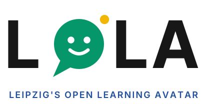
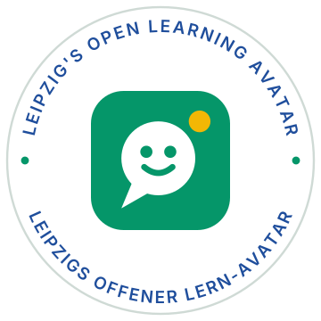

<p align="center">
  <picture>
    <source media="(prefers-color-scheme: dark)" srcset="docs/lola-icon-svgs/lola-logo-en-dark-bg.svg">
    
  </picture>
</p>

<p align="center">
  <a href="LICENSE"></a>
  <a href=".github/workflows/docker-publish.yml"></a>
  <a href="ATTRIBUTION.md"></a>
  
  
  
  
  
  
</p>

**LOLA builds talking 3D avatars and publishes them as a link.** A researcher describes a persona, picks an AI model, a voice and a 3D face, and shares the public URL. Visitors, usually students, chat with the avatar by typing or speaking, without an account. Afterwards the conversations can be reviewed in an analytics dashboard.

> **Research tool first.** LOLA is built primarily for **education researchers**. It has not yet been proof-tested or didactically evaluated, so don't rely on it for teaching or assessment without that groundwork. Teachers are welcome to try it, ideally together with a research team.

## Contents

[Features](#features) · [Quick start](#quick-start) · [Optional services](#optional-services) · [Architecture](#architecture) · [AI providers](#ai-providers) · [Using LOLA](#using-lola) · [Data privacy](#data-privacy) · [Tech stack](#tech-stack) · [Documentation](#documentation) · [Credits and licence](#credits-and-licence) · [AI notice](#ai-notice)

## Features

- **Persona:** describe the behaviour in plain language (system prompt); pick one of two bundled 3D faces (Julia, David) or upload your own, plus a background and a voice.
- **Talk by typing or speaking:** speech is transcribed on the visitor's device (server fallback), the avatar answers aloud with lip-sync.
- **Body language:** the AI adds gestures (nod, wave, thumbs up, …) from a curated list. [Details](docs/avatar-gestures-plan.md#gestures)
- **Conversation plan:** steps the avatar works through and ticks off, with a progress card for students. [Details](docs/avatar-gestures-plan.md#conversation-plan)
- **Pronunciation word list:** per-language rules for how terms, units and abbreviations are spoken ("13,9 m/s" → "13,9 Meter pro Sekunde"), with a physics pack, CSV import/export and a test box.
- **Knowledge bases (RAG):** attach PDFs, Word or Markdown files; matching passages are given to the AI before each reply, with any provider.
- **Access control:** optional password per chat, optional visitor name or ID.
- **Bring your own keys:** Anthropic, OpenAI, Gemini, Mistral, Ollama, OpenAI-compatible endpoints, Cartesia, Google Cloud TTS, GWDG Arcana. [Providers](#ai-providers)
- **Analytics:** sessions, messages, per-conversation transcripts, CSV/ZIP export, latency test page.
- **Answer-quality evaluation:** test questions scored by a judge LLM with [Ragas](https://github.com/explodinggradients/ragas).
- **English and German** UI.

## Quick start

Both paths read one `.env` file at the repo root.

```bash
cp .env.example .env
```

Set the two required secrets (the app refuses to start with placeholders, short values or an invalid Fernet key):

| Variable | Generate with |
|---|---|
| `JWT_SECRET` | `python3 -c "import secrets; print(secrets.token_urlsafe(48))"` |
| `API_KEY_ENCRYPTION_SECRET` | `python3 -c "from cryptography.fernet import Fernet; print(Fernet.generate_key().decode())"` |

Every other variable is commented in [`.env.example`](.env.example) with the deploy path that uses it.

### Local development

Needs Python ≥ 3.11 and Node.js. [`scripts/dev.py`](scripts/dev.py) sets up and starts the backend, the frontend and every optional service enabled in `.env`:

```bash
python3 scripts/dev.py setup   # once, and after dependency changes
python3 scripts/dev.py         # Ctrl+C stops everything
```

On Windows use `py -3.11 scripts/dev.py …`. Name services to pick them, e.g. `python3 scripts/dev.py start backend frontend rag`. The frontend runs at `http://localhost:5173` (proxies `/api` to the backend on `:8000`).

<details>
<summary>Manual steps (backend, frontend, Windows)</summary>

```bash
cd backend
python3 -m venv .venv && source .venv/bin/activate
pip install -e .
python -m alembic upgrade head
uvicorn app.main:app --reload        # http://localhost:8000, health: GET /health
```

```bash
cd frontend
npm install
npm run dev                          # http://localhost:5173
```

On Windows (PowerShell), activate with `.\.venv\Scripts\Activate.ps1` and start with `python -m uvicorn app.main:app --reload`. If `uvicorn` is "not recognized", the virtual environment is not active in that window. If activation is blocked, run `Set-ExecutionPolicy -Scope CurrentUser RemoteSigned` once.

More: [backend/README.md](backend/README.md), [frontend/README.md](frontend/README.md).
</details>

**First admin account:** set `ADMIN_EMAIL` and `ADMIN_PASSWORD` in `.env` and run `python -m app.cli.bootstrap_admin` from `backend/` (idempotent; `scripts/dev.py` and Docker run it on every start), or promote an existing account in the database. Admins manage accounts, site settings and the public pages (imprint, privacy policy, landing page, accessibility statement).

**On-device speech models** (optional): run `scripts/fetch-stt-model.sh` (~380 MB) so voice input is transcribed in the browser; without it the server transcribes. Details and browser requirements: [docs/on-device-speech.md](docs/on-device-speech.md).

### Docker (production)

Prebuilt images behind a Caddy reverse proxy. TLS is expected to be terminated upstream (e.g. a Cloudflare Tunnel). Built for TrueNAS SCALE, works on any Docker host.

```bash
docker compose -f docker/docker-compose.yml --env-file .env up -d
```

The `web` service listens on port `30080`. Full guide, including the systemd unit: [docker/README.md](docker/README.md).

## Optional services

All are off by default and switched on in `.env` (and, for Docker, with a Compose profile).

| Service | Purpose | Enable | Docs |
|---|---|---|---|
| [`local-tts/`](local-tts/) | Speech output without a cloud key (Kyutai [Pocket TTS](https://github.com/kyutai-labs/pocket-tts), 23 preset voices, optional voice cloning) | `LOCAL_TTS_ENABLED=true`, `LOCAL_TTS_URL` | [local-tts/README.md](local-tts/README.md) |
| [`rag/`](rag/) | Knowledge base: sandboxed parsing, local embeddings, search | `RAG_ENABLED=true`, `RAG_SERVICE_URL`, `RAG_SERVICE_TOKEN` | [rag/README.md](rag/README.md), [design](docs/rag-plan.md) |
| [`rag-eval/`](rag-eval/) | Answer-quality scoring with Ragas | `RAG_EVALUATION_ENABLED=true`, `RAG_EVAL_SERVICE_URL`; needs `rag` | [rag-eval/README.md](rag-eval/README.md) |
| docling-serve | Layout-aware parsing and OCR for the knowledge base | `DOCLING_URL` on the `rag` service | [docker/README.md](docker/README.md) |

## Architecture

| Part | What it is | Docs |
|---|---|---|
| [`backend/`](backend/) | FastAPI API: auth, projects, LLM/TTS/STT calls, analytics (SQLite) | [backend/README.md](backend/README.md) |
| [`frontend/`](frontend/) | React + TypeScript SPA; 3D avatar with three.js and [TalkingHead](https://github.com/met4citizen/TalkingHead) | [frontend/README.md](frontend/README.md) |
| [`docker/`](docker/) | Images, Compose file, Caddy config | [docker/README.md](docker/README.md) |
| Optional services | see above | |

<p align="center">
  
</p>

### How a chat message is processed

<p align="center">
  
</p>

## AI providers

Each project picks its own LLM and, optionally, a TTS voice. Users connect them with their own API key (Dashboard → API Keys).

| Provider | Used for |
|---|---|
| Anthropic, Mistral, Ollama, OpenAI-compatible endpoint | LLM |
| OpenAI, Google Gemini | LLM + TTS |
| Cartesia, Google Cloud TTS | TTS |
| GWDG Arcana | LLM (with its own knowledge base) |

Speech-to-text needs no key. Details, the Thinking setting and custom endpoints: [docs/ai-providers.md](docs/ai-providers.md).

## Using LOLA

**Teachers** (an admin or institution may already run an instance, so nothing to install):

1. Log in or register, then create a project: name, avatar, background.
2. Connect an AI provider key, or use one your admin provides.
3. Describe the persona and preview the chat in the wizard.
4. Publish for a shareable link (optionally with a password or a required visitor name). Publishing saves your latest changes first.
5. Review conversations under Analytics.

**Researchers:**

- **Data control:** self-host so conversation data stays on your infrastructure.
- **Export:** individual sessions or a bulk ZIP for offline analysis.
- **Compare providers:** keys are swappable per project, so the same persona can run on different LLMs or voices; compare cost, latency and answer quality.
- **Measure quality:** knowledge bases record which document and page each reply cites; the evaluation module scores faithfulness, relevance, precision, recall and correctness, and compares runs side by side.
- **Measure latency:** every response is timed server-side (LLM, TTS, STT), the **Latency test** page runs scripted conversations on any device and compares configurations. See [docs/latency-test.md](docs/latency-test.md) and [backend/README.md](backend/README.md#latency-monitoring).

## Data privacy

- LOLA does not phone home. Accounts, settings and conversations stay on the server you deploy to.
- **Every chat message goes to the AI provider the project uses**, and that provider's terms apply. Voice audio leaves the visitor's device only on the server fallback or with a cloud STT key.
- Password-reset emails (only with SMTP configured) are the backend's only other outbound traffic.
- Knowledge bases stay on your server with the default local embedding model. An API embedding model receives the full text of the documents at indexing. Original files are deleted once indexed (kept up to 24 hours if indexing fails, for a retry); deleting a document, knowledge base or account deletes its indexed text. Material attached to a published project can be quoted by anyone with the link.
- An admin can set a conversation retention period (Admin → Settings); it is enforced continuously, re-checked every few hours.
- Whether a deployment satisfies your institution's data-protection rules (e.g. GDPR) is yours to assess; the project provides no data-processing agreement or legal review.

## Tech stack

| Layer | Technology |
|---|---|
| Backend | FastAPI, SQLite via SQLModel/SQLAlchemy, Alembic migrations, JWT + bcrypt |
| LLM / TTS | [litellm](https://github.com/BerriAI/litellm) |
| Speech-to-text | [Parakeet Redux](https://huggingface.co/moondream/parakeet-redux) on the device ([onnxruntime-web](https://onnxruntime.ai/) + WebGPU); [faster-whisper](https://github.com/SYSTRAN/faster-whisper) on the server as fallback |
| Text-to-speech normalisation | [normt2s](https://github.com/c-siegel/normt2s) |
| Local TTS (optional) | Kyutai [Pocket TTS](https://github.com/kyutai-labs/pocket-tts) sidecar; also in the browser for the latency test |
| Frontend | React 18, TypeScript, Vite, TanStack Query |
| 3D avatar | three.js, [TalkingHead](https://github.com/met4citizen/TalkingHead), [HeadAudio](https://github.com/met4citizen/HeadAudio), [MotionEngine](https://github.com/lhupyn/motion-engine) |
| Deployment | Docker Compose + Caddy (defaults for TrueNAS SCALE; change `PUID`/`PGID` in `.env`) |

## Documentation

| Topic | Where |
|---|---|
| Backend API, services, security, tests | [backend/README.md](backend/README.md) |
| Frontend structure and conventions | [frontend/README.md](frontend/README.md) |
| Docker deployment, Compose profiles, backups | [docker/README.md](docker/README.md) |
| AI providers | [docs/ai-providers.md](docs/ai-providers.md) |
| On-device speech: models and browser requirements | [docs/on-device-speech.md](docs/on-device-speech.md) · [device test](docs/stt-device-test.md) |
| Avatar, gestures, conversation plan | [docs/avatar-gestures-plan.md](docs/avatar-gestures-plan.md) |
| Knowledge base design | [docs/rag-plan.md](docs/rag-plan.md) |
| Latency test | [docs/latency-test.md](docs/latency-test.md) |
| Open work, deployment checklist | [docs/open-work.md](docs/open-work.md) · [DEPLOYMENT_CHECKLIST.md](DEPLOYMENT_CHECKLIST.md) |
| Working on the repo with AI agents | [AGENTS.md](AGENTS.md) |

CI ([tests.yml](.github/workflows/tests.yml)) runs the backend and service tests, the licence gate and the frontend build on every pull request to `working-branch` or `main`. Tagged releases ([docker-publish.yml](.github/workflows/docker-publish.yml)) run the same checks before images are published. [Renovate](renovate.json) keeps a *Dependency dashboard* issue listing every dependency (Python, npm, Docker images, GitHub Actions) and opens grouped update PRs against `working-branch` every Monday.

## Credits and licence

LOLA is MIT-licensed, see [LICENSE](LICENSE). Every third-party component, model and font with its licence is listed in **[ATTRIBUTION.md](ATTRIBUTION.md)**; the same credits are in the app at `/credits`. Key ones: [TalkingHead](https://github.com/met4citizen/TalkingHead) and [HeadAudio](https://github.com/met4citizen/HeadAudio) (Mika Suominen, MIT), [MotionEngine](https://github.com/lhupyn/motion-engine) (lhupyn, MIT), Kyutai's [Pocket TTS](https://github.com/kyutai-labs/pocket-tts) (CC BY 4.0 weights and voices).

## AI notice

- **In the product:** the avatar's replies are generated by an AI language model and can be wrong, biased or inappropriate. Visitors are talking to a machine, not a person; operators should say so in their own privacy policy and instructions.
- **In the repo:** much of the code and documentation was written with AI coding assistants (Claude Code by Anthropic). Changes arrive through pull requests, and the AI tools involved are credited in the commit history (`Co-Authored-By`).

<p align="center">
  
</p>
